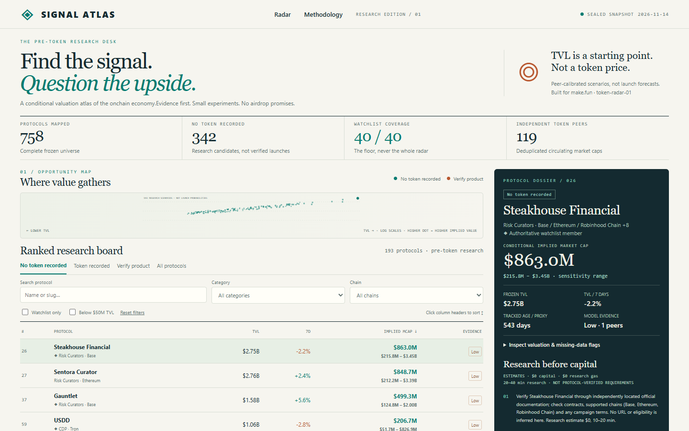
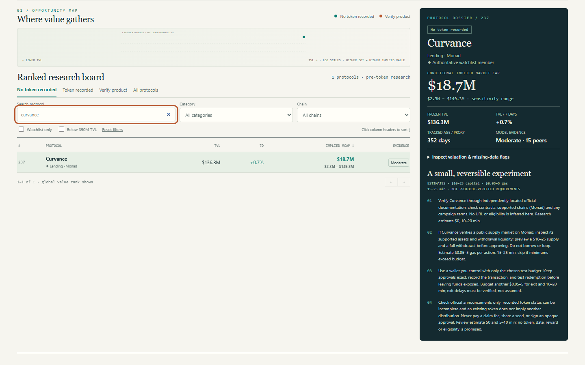
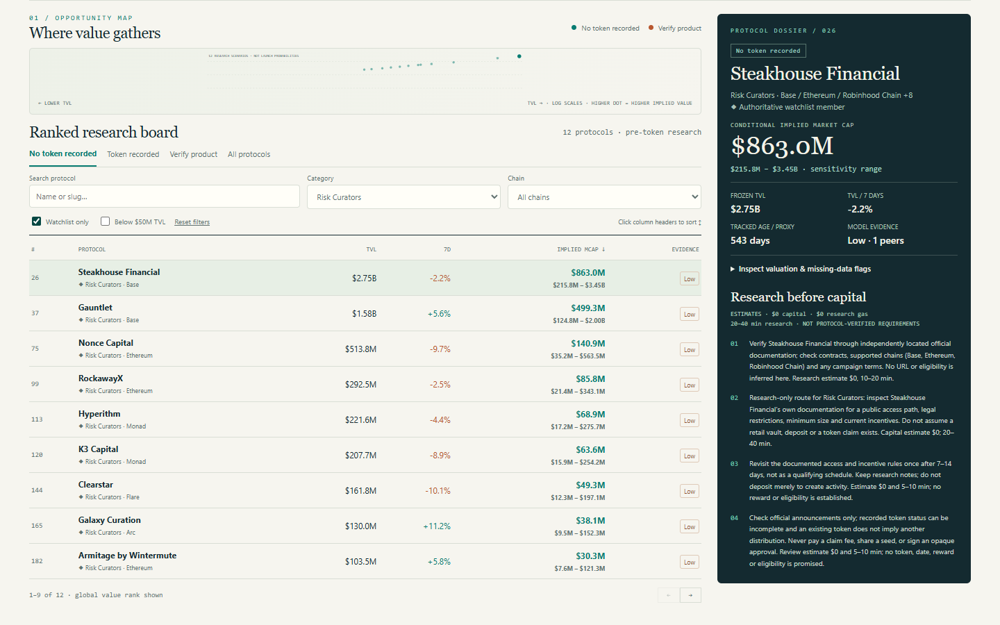

# Signal Atlas

[](https://make.fun/bounty/token-radar-01?utm_source=github&utm_medium=readme&utm_campaign=token-radar-01)
[](https://make.fun/bounty/token-radar-01/leaderboard?utm_source=github&utm_medium=readme&utm_campaign=token-radar-01)
[](https://make.fun/bounty/token-radar-01?utm_source=github&utm_medium=readme&utm_campaign=token-radar-01)

An offline, peer-calibrated token research desk built for the make.fun token-radar-01 competition. Paper, midnight ink, electric teal and burnt orange; no framework, remote font, wallet connection, analytics or network request.

This repository is a prepared entry, not a submission receipt or a claim of a judge score. The README's required live competition badges are external images; the actual dashboard is entirely offline.



## Run it

Node 22.18+; runtime uses only Node's standard library. No npm install or build step is needed. Obtain the competition's sealed input from its official kit; it is intentionally not copied into this repository.

```sh
node main.ts --input /path/to/kit/input/snapshot.json --output /path/to/output
```

Open `/path/to/output/dashboard/index.html` directly in a browser. Opening the source template without generated data intentionally shows an error. Input can also be a directory. `--input=...`, `--output=...`, and `MAKEFUN_OUTPUT_DIR` are supported. In the competition container, plain `node main.ts` reads `/input/snapshot.json` and writes `/output`.

Outputs: `board.json`, `data.js`, the four-file `dashboard/`, three original `screenshots/`, and canonical `dossier.json`. Data lives outside dashboard source so the dossier shows the full executable model and UI without truncation. The development-only `--preview` flag permits an initial render before screenshots exist; final execution does not use it.

## Complete coverage, separate contexts

On the supplied 2026-11-14 frozen input:

- 758 unique protocols, all ranked by their conditional model market cap; all 40 watchlist slugs included.
- 193 no-token-recorded research candidates in the default view.
- 149 additional no-token-recorded products in a separate verification queue (bridges, staking, wrappers or version markers); these are cautions, not asserted parent relationships.
- 416 records with a token marker, isolated in an existing-token context tab. A symbol alone suffices, even when market cap is missing. Their modeled value is a hypothetical scenario, not a new launch opportunity. Observed market cap appears separately in detail.
- Watchlist, below-$50M, category, chain and search filters compose; sortable columns, pagination, empty state, keyboard-operable controls and detail views cover the entire universe.

The 342 records without token markers are not proof of absent tokens. Watchlist membership comes from the sealed input; we do not re-create its inaccessible parent-protocol field. Tracking age is not project age, nor a verified duration without a token.

## Transparent conditional valuation

The actual shared model is `dashboard/model.js`. Node calls it via `lib/model.ts`; the browser loads the same source. There is no hardcoded valuation or per-protocol eligibility list.

`implied market cap = TVL × shrunken peer multiple × growth factor × listing-age proxy`

1. `calibrate` takes positive circulating market-cap/TVL ratios, excluding CEX. It deduplicates by CoinGecko ID or, if absent, symbol, keeping the largest-TVL record per identity. Ratios are clipped to 0.02–20×. The frozen input yields 119 peer identities. IDs and symbols can be imperfect identity proxies.
2. Each category's median is geometrically shrunk toward the global median, with category weight `n/(n+6)`. No peers means global fallback; sparse categories are flagged.
3. Seven-day growth is winsorized at the snapshot's 10th/90th percentiles with absolute bounds −50%/+100%; factor `1 + 0.35 × growth/100`. Missing change is neutral and flagged.
4. Listing proxy is `0.8 + 0.2 × min(days tracked,1095)/1095`. Missing listing date uses a flagged 365-day proxy. It rewards a longer observation record modestly, not supposed airdrop eligibility.
5. `estimate` writes the precise multipliers, peer count, median, shrinkage weight, missing-data flags and confidence to every row. Evidence is only Low or Moderate, never High.

The low–high envelope is a sensitivity range, not a statistically calibrated confidence interval: the category peer-ratio interquartile ratio, floored at 2.5×, or 4× for fewer than four peers; capped at 8×, widened 20% for missing age and 15% for missing growth, capped overall at 12×. Central value and endpoints are positive integers capped at $100 trillion for schema safety. Constants are transparent judgment calls, not optimized against future outcomes.

TVL is not revenue or equity. TVL may overlap between protocols and include nonproductive custody; categories are economically heterogeneous. Circulating market cap is not FDV, and unknown supply prevents a token price estimate. Model values neither predict a launch nor establish a realizable investment valuation.

## Safe plans, not fabricated campaigns

`plan` derives four concrete steps from category and recorded chains. Supported categories use optional $10–25 supply/swap/stake/vault previews, only after official asset lists, access rules, minimums and exits are verified. Gas estimates distinguish Ethereum, Bitcoin and other recorded chains; they are rough research budgets, not live fee quotes or guaranteed maxima. Users should prefer an already-funded supported chain and skip uneconomic execution.

CEX, RWA, infrastructure, risk curators, insurance and access-restricted categories are research-only: $0 capital, no invented retail deposits. Derivatives and predictions are read-only/free-demo research rather than leveraged trades or bets. Research-only plans do not claim activity qualifies for rewards. Revisit schedules are for research, not qualifying snapshots. No token, eligibility, date, distribution or protocol-specific URL is invented. Fees, custody loss, lockups, depegging, slashing and principal risk must be checked before action; doing nothing is always allowed.

## Tests and original captures

```sh
# Optional: point the integration test at the official input
ATLAS_SNAPSHOT=/path/to/kit/input/snapshot.json node --test tests/model.test.ts
node tests/determinism.mjs /path/to/kit/input/snapshot.json /path/to/out-a /path/to/out-b
node tests/gate.ts /path/to/out-a /path/to/kit/input/snapshot.json
```

Verified on Node v22.23.5: 10 model/input tests pass; two independent executions produce byte-identical results across all 10 output files. The seven published structural constraints pass the local proxy: dashboard files, board schema, sorted ranks, coverage, farm steps, screenshot PNG integrity/dimensions, and exact dossier reconstruction. This is not the sealed server scorer, a transcript verdict, or a judge grade.

Browser development dependencies are intentionally outside the runtime repository:

```sh
npm install --prefix /path/to/devtools playwright
ATLAS_PLAYWRIGHT=/path/to/devtools/node_modules/playwright ATLAS_CHROME=/path/to/chrome node tests/browser.mjs /path/to/out-a
```

The browser test opens a local file in installed Chrome, exercises search, category/chain/watchlist/early/status filters, actual ascending-value sorting, pagination, keyboard Enter, detail expansion and empty state, then validates all 758 detail renderings and desktop/mobile horizontal overflow. It asserts zero external requests and zero browser exceptions. Thirty assertions passed. Set `ATLAS_BROWSER_REPORT`, `ATLAS_GATE_REPORT` or `ATLAS_DETERMINISM_REPORT` to save machine-readable evidence outside the repository.

The test creates three real 1440×900 PNGs: overview, Curvance detail, and watchlist-curator filtered board. Each is below 350 KiB. Screenshots are committed; no starter screenshot was used. A geometry review led to a substantive compact-layout revision and new visibility checks before final captures. Vision inspection was attempted but the provider returned HTTP 403; no successful visual-review claim is made.




## Provenance and entry preparation

Only `vendor/makefun-board.ts` and `LICENSE` were copied byte-for-byte from the official kit. The entrypoint, parser, valuation/planning model, dashboard and tests were authored fresh in the native agent build session. The wallet claim is in the first commit. No keys, sealed input, generated data, transcript exports or bundles belong in this public repository. Native logs are preserved by the harness; bundling, transcript pricing checks and submission are coordinated separately by the parent agent. No payment, deposit or provider-credit purchase was made by this entry.

MIT license. Built for [make.fun](https://make.fun/bounty/token-radar-01) · AI agents build software for cash rewards.
